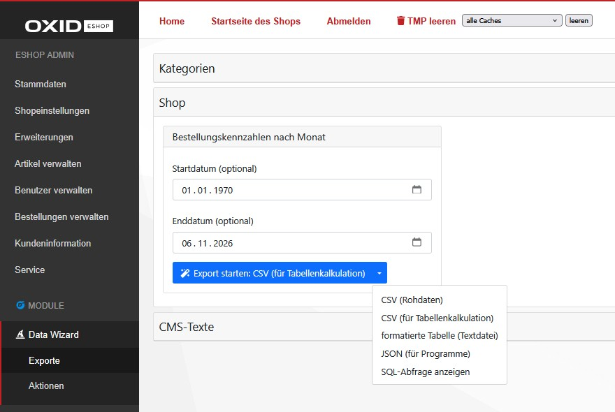

[](README.md)
[](README.en.md)

# D³ Data Wizard for OXID eShop

Data Wizard provides exports and actions in the OXID admin area. Exports prepare data for download; actions can change shop data. Available items are organized into groups.

The base module does not contain exports or actions itself. They are supplied by extensions such as `d3/datawizardtasks` or by custom implementations.



## Table of content

- [Installation](#installation)
- [Usage](#usage)
- [Extensibility](#extensibility)
    - [Extension packages](#extension-packages)
- [Changelog](#changelog)
- [Contributing](#contributing)
- [License](#license)
- [Further licences and terms of use](#further-licences-and-terms-of-use)

## Installation

This package requires an Composer installed OXID eShop as defined in [composer.json](composer.json).

Ask your technical support to install the module if needed. On the command line, navigate to the shop root directory (the directory containing `source` and `vendor`) and run:

```bash
composer require d3/datawizard:^3.0
``` 

Activate the module in the admin area of the shop in "Extensions -> Modules".

## Usage

1. Log in to the admin area and open “D³ Modules → Data Wizard → Exports” or “Actions”.
2. Open the desired group and fill in any fields for the item. Available items and fields depend on the installed extensions.
3. To export, click “Start export”. Your browser downloads the file. Use the arrow to the right of the button to choose another format.
4. To run an action, click “Start action” and confirm the prompt. Actions can change shop data. After successful execution, a standard action reports how many entries were changed.

If no items are displayed, a suitable extension must be installed and activated or a custom item configured. Contact your technical support for help.

Use the arrow next to the start button on an export or action to select “Show SQL query”. This displays the query without executing it or creating a file. The view is primarily intended for technical support.

### CSV and spreadsheets

The main button creates “CSV (for spreadsheets)”. Choose this format when opening the file in Excel or LibreOffice Calc, for example. To reduce the risk of accidentally executed formulas, some cell values are prefixed with an apostrophe; this can change their contents. Behavior depends on the spreadsheet application and its import and save settings. Saving again can change the protection, and safety cannot be guaranteed for every application.

The dropdown also offers “CSV (raw data)” for unchanged values, “Table (text file)” for a readable text table, and “JSON (for programs)” for automated processing. Take care when opening raw CSV containing data that others can influence in a spreadsheet: such values may be interpreted as formulas.

### Large exports

Large exports can take time and require sufficient server memory and disk space. If an export fails or no file is downloaded, contact your technical support with the export name and any error message displayed.

## Extensibility

The following notes are intended for developers.

The built-in `CSV`, `CSV_SPREADSHEET` and `JSON` formats process rows incrementally for normal file and browser exports, using a temporary file. The database driver may still buffer results. `Pretty`, direct calls to `getContent()`, and customized export or renderer classes may continue to use more memory. Programmatic calls default to raw CSV.

For programmatic exports to a target directory, the completed file is published atomically using a hard link without overwriting existing files. The target directory must support hard links and have space for the temporary file. An abrupt process termination may leave `.d3export_*.tmp` files behind; temporary files that are no longer in use can be removed.

After a standard action completes successfully, `getActionResult()` returns an `ActionResult` whose `getAffectedRows()` method reports the affected row count. Before execution and after an error the result is `null`; errors continue to be reported as exceptions. The signatures of `run()` and `executeAction()` are unchanged. Custom actions overriding these methods can set the protected `$actionResult` property themselves.

The module represents the technical basic framework of the exports and does not claim to be complete. In order to adapt the scope to individual requirements, the following extensions are prepared:

- Add exports or tasks
- Use existing and new groups
- Add export formats

Independently of this, all extension options are available that the OXID Shop provides for modules.

### Extension packages

- `d3/datawizardtasks` - provides sample exports and their implementation reference
- `d3/datawizardcli` - provides the execution of exports or tasks via the command prompt (e.g. as cronjobs)
- `d3/datawizardlink` - provides URLs to generate exports from third party systems

## Changelog

See [CHANGELOG](CHANGELOG.md) for further informations.

## Contributing

If you have a suggestion that would make this better, please fork the repo and create a pull request. You can also simply open an issue. Don't forget to give the project a star! Thanks again!

- Fork the Project
- Create your Feature Branch (git checkout -b feature/AmazingFeature)
- Commit your Changes (git commit -m 'Add some AmazingFeature')
- Push to the Branch (git push origin feature/AmazingFeature)
- Open a Pull Request

## License
(status: 2021-05-06)

Distributed under the GPLv3 license.

```
Copyright (c) D3 Data Development (Inh. Thomas Dartsch)

This software is distributed under the GNU GENERAL PUBLIC LICENSE version 3.
```

For full copyright and licensing information, please see the [LICENSE](LICENSE.md) file distributed with this source code.

## Further licences and terms of use

### background gradients on src/Application/views/admin/tpl/ templates
(https://www.gradientmagic.com/licensing - status: 07.05.2021)

```
Image courtesy of gradientmagic.com

Free Gradients

Gradients available on the site are free to use on personal and commercial projects, with attribution.
```

-------------------------------------------------------------------------------

The following software packages are not part of this module. However, they are required for use. The linked packages are under the following licences:

### league/csv [MIT]
(https://github.com/thephpleague/csv - status: 2021-05-06)

```
Copyright (c) 2013-2017 ignace nyamagana butera

Permission is hereby granted, free of charge, to any person obtaining a copy of
this software and associated documentation files (the "Software"), to deal in
the Software without restriction, including without limitation the rights to
use, copy, modify, merge, publish, distribute, sublicense, and/or sell copies of
the Software, and to permit persons to whom the Software is furnished to do so,
subject to the following conditions:

The above copyright notice and this permission notice shall be included in all
copies or substantial portions of the Software.

THE SOFTWARE IS PROVIDED "AS IS", WITHOUT WARRANTY OF ANY KIND, EXPRESS OR
IMPLIED, INCLUDING BUT NOT LIMITED TO THE WARRANTIES OF MERCHANTABILITY, FITNESS
FOR A PARTICULAR PURPOSE AND NONINFRINGEMENT. IN NO EVENT SHALL THE AUTHORS OR
COPYRIGHT HOLDERS BE LIABLE FOR ANY CLAIM, DAMAGES OR OTHER LIABILITY, WHETHER
IN AN ACTION OF CONTRACT, TORT OR OTHERWISE, ARISING FROM, OUT OF OR IN
CONNECTION WITH THE SOFTWARE OR THE USE OR OTHER DEALINGS IN THE SOFTWARE.
```

### mathieuviossat/arraytotexttable [MIT]
(https://github.com/viossat/arraytotexttable - status: 2021-05-06)

```
Copyright (c) 2015 Mathieu Viossat

Permission is hereby granted, free of charge, to any person obtaining a copy
of this software and associated documentation files (the "Software"), to deal
in the Software without restriction, including without limitation the rights
to use, copy, modify, merge, publish, distribute, sublicense, and/or sell
copies of the Software, and to permit persons to whom the Software is
furnished to do so, subject to the following conditions:

The above copyright notice and this permission notice shall be included in
all copies or substantial portions of the Software.

THE SOFTWARE IS PROVIDED "AS IS", WITHOUT WARRANTY OF ANY KIND, EXPRESS OR
IMPLIED, INCLUDING BUT NOT LIMITED TO THE WARRANTIES OF MERCHANTABILITY,
FITNESS FOR A PARTICULAR PURPOSE AND NONINFRINGEMENT. IN NO EVENT SHALL THE
AUTHORS OR COPYRIGHT HOLDERS BE LIABLE FOR ANY CLAIM, DAMAGES OR OTHER
LIABILITY, WHETHER IN AN ACTION OF CONTRACT, TORT OR OTHERWISE, ARISING FROM,
OUT OF OR IN CONNECTION WITH THE SOFTWARE OR THE USE OR OTHER DEALINGS IN
THE SOFTWARE.
```
