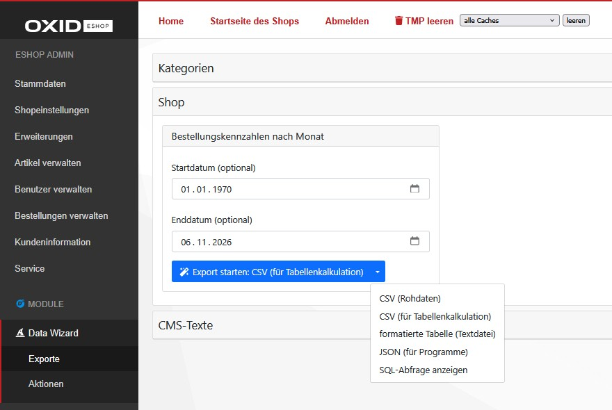

[](README.md)
[](README.en.md)

# D³ Data Wizard für OXID eShop

Der Data Wizard stellt im OXID-Adminbereich Exporte und Aktionen bereit. Exporte bereiten Daten für den Download auf; Aktionen können Daten im Shop verändern. Die verfügbaren Einträge sind zur besseren Übersicht in Gruppen zusammengefasst.

Das Grundmodul enthält selbst keine Exporte oder Aktionen. Diese werden durch Erweiterungen wie `d3/datawizardtasks` oder durch individuelle Anpassungen bereitgestellt.



## Inhaltsverzeichnis

- [Installation](#installation)
- [Verwendung](#verwendung)
- [Erweiterbarkeit](#erweiterbarkeit)
    - [Erweiterungspakete](#erweiterungspakete)
- [Changelog](#changelog)
- [Beitragen](#beitragen)
- [Lizenz](#lizenz)
- [weitere Lizenzen und Nutzungsbedingungen](#weitere-lizenzen-und-nutzungsbedingungen)

## Installation

Dieses Paket erfordert einen mit Composer installierten OXID eShop in einer in der [composer.json](composer.json) definierten Version.

Lassen Sie die Installation bei Bedarf von Ihrer technischen Betreuung durchführen. Wechseln Sie auf der Kommandozeile in das Stammverzeichnis des Shops (das Verzeichnis mit `source` und `vendor`) und führen Sie folgenden Befehl aus:


```bash
composer require d3/datawizard:^3.1
``` 

Aktivieren Sie das Modul im Shopadmin unter "Erweiterungen -> Module".

## Verwendung

1. Melden Sie sich im Adminbereich an und öffnen Sie „D³ Module → Data Wizard → Exporte“ oder „Aktionen“.
2. Öffnen Sie die gewünschte Gruppe und füllen Sie gegebenenfalls die Felder des Eintrags aus. Welche Einträge und Felder verfügbar sind, hängt von den installierten Erweiterungen ab.
3. Für einen Export klicken Sie auf „Export starten“. Die Datei wird über Ihren Browser heruntergeladen. Mit dem Pfeil rechts neben dem Button können Sie ein anderes Format auswählen.
4. Für eine Aktion klicken Sie auf „Aktion starten“ und bestätigen die Rückfrage. Aktionen können Shopdaten verändern. Nach erfolgreicher Ausführung zeigt eine Standardaktion an, wie viele Einträge verändert wurden.

Falls keine Einträge angezeigt werden, muss eine passende Erweiterung installiert und aktiviert oder ein individueller Eintrag eingerichtet werden. Wenden Sie sich dafür an Ihre technische Betreuung.

Über den Pfeil rechts neben dem Start-Button können Sie bei geeigneten Exporten und Aktionen „SQL-Abfrage anzeigen“ wählen. Die Abfrage wird dann angezeigt, aber nicht ausgeführt; es wird keine Datei erstellt. Einträge ohne SQL-Abfrage bieten diese Option nicht an. Prüfungen bei der Abfrageerstellung können auch in der Vorschau eine Fehlermeldung auslösen. Diese Ansicht ist vor allem für die technische Betreuung gedacht.

### CSV und Tabellenkalkulation

Der Hauptbutton erstellt „CSV (für Tabellenkalkulation)“. Wählen Sie dieses Format, wenn Sie die Datei beispielsweise in Excel oder LibreOffice Calc öffnen möchten. Zum Schutz vor unbeabsichtigt ausgeführten Formeln werden bestimmte Zellinhalte mit einem Apostroph versehen; dadurch können sich Werte ändern. Das Verhalten hängt vom Tabellenprogramm und seinen Import- und Speicheroptionen ab. Insbesondere kann erneutes Speichern den Schutz verändern; eine Garantie für alle Programme besteht nicht.

Im Aufklappmenü stehen außerdem „CSV (Rohdaten)“ für unveränderte Werte, „formatierte Tabelle (Textdatei)“ für eine lesbare Texttabelle und „JSON (für Programme)“ für die technische Weiterverarbeitung zur Verfügung. Öffnen Sie Rohdaten-CSV mit fremdbeeinflussbaren Inhalten nicht unbedacht in einem Tabellenprogramm: Solche Inhalte können als Formeln interpretiert werden.

### Große Exporte

Große Exporte können Zeit sowie ausreichend Arbeitsspeicher und Speicherplatz auf dem Server benötigen. Falls ein Export abbricht oder keine Datei heruntergeladen wird, wenden Sie sich mit dem Namen des Exports und einer gegebenenfalls angezeigten Fehlermeldung an Ihre technische Betreuung.

## Erweiterbarkeit

Die folgenden Hinweise richten sich an Entwicklerinnen und Entwickler.

Die eingebauten Formate `CSV`, `CSV_SPREADSHEET` und `JSON` verarbeiten Ergebniszeilen beim normalen Datei- und Browserexport schrittweise und verwenden eine temporäre Datei. Auch eigene Renderer mit `StreamingRendererInterface` können diesen Pfad nutzen. Überschreibt ein Export eine der Methoden `getContent`, `getExportData`, `renderContent`, `getDownload` oder `saveExportFile`, wird aus Kompatibilitätsgründen der reguläre gepufferte Pfad verwendet. `Pretty` und direkte Aufrufe von `getContent()` verwenden ebenfalls diesen Pfad. Der Datenbanktreiber kann Ergebnisse auch beim Streaming puffern. Programmatische Aufrufe verwenden standardmäßig Rohdaten-CSV.

Für eigene Tasks erweitern Sie die Registry `D3\DataWizard\Application\Model\Configuration` über die OXID-Modulkette und registrieren Instanzen mit `registerExport()` beziehungsweise `registerAction()`. Implementierungen erweitern `ExportBase` oder `ActionBase` und liefern für SQL-basierte Tasks aus `getQuery()` ein Array `[SQL, Parameter]`. Binden Sie Eingabewerte als Parameter und validieren Sie sie serverseitig. Die Vorschau ruft `getQuery()` direkt auf und führt die reguläre Formularvalidierung in `run()` nicht aus.

Ein Task ohne SQL kann `hasQuery()` mit `false` überschreiben, um die Vorschau auszublenden. `getQuery()` bleibt Teil des Vertrags und liefert beispielsweise `['', []]`; die eigene Implementierung muss auch die Datenbeschaffung beziehungsweise Ausführung ohne SQL bereitstellen. Ein Export kann dazu `getExportData()` überschreiben; dadurch verwendet er den gepufferten Pfad. Die Beispiele und eine detaillierte Integrationsanleitung finden Sie in `d3/datawizardtasks`.

Zusätzliche Exportformate registrieren Sie über eine OXID-Erweiterung der `ExportRenderer\RendererBridge::getRendererList()` und implementieren `RendererInterface`. Für inkrementelle Ausgabe implementiert der Renderer zusätzlich `StreamingRendererInterface`; der aufrufende Code besitzt und schließt den übergebenen Stream.

Bei programmatischen Exporten in ein Zielverzeichnis wird die fertige Datei über einen Hardlink atomar veröffentlicht, ohne vorhandene Dateien zu überschreiben. Das Zielverzeichnis muss Hardlinks unterstützen und Platz für die temporäre Datei bieten. Nach einem abrupten Prozessabbruch können `.d3export_*.tmp`-Dateien zurückbleiben; nicht mehr verwendete temporäre Dateien können entfernt werden.

Nach einer erfolgreich ausgeführten Standard-Action liefert `getActionResult()` ein `ActionResult` mit der Anzahl betroffener Zeilen über `getAffectedRows()`. Vor der Ausführung und nach einem Fehler ist das Ergebnis `null`; Fehler werden weiterhin als Exceptions gemeldet. Die Signaturen von `run()` und `executeAction()` bleiben unverändert. Eigene Actions, die diese Methoden überschreiben, können das geschützte Feld `$actionResult` selbst setzen.

Das Modul stellt das technische Grundgerüst der Exporte dar und erhebt keinen Anspruch auf Vollständigkeit. Um den Umfang an die individuellen Anforderungen anzupassen, sind folgende Erweiterungen vorbereitet:

- Exporte oder Tasks hinzufügen
- Verwendung bestehender und neuer Gruppen
- Exportformate ergänzen

Unabhängig dessen stehen alle Erweiterungsmöglichkeiten zur Verfügung, die der OXID Shop für Module bereitstellt.

### Erweiterungspakete

- `d3/datawizardtasks` - liefert Beispielexporte und deren Implementierungsreferenz
- `d3/datawizardcli` - ermöglicht die Ausführung der Exporte oder Tasks über die Eingabeaufforderung (z.B. als Cronjobs)
- `d3/datawizardlink` - stellt URLs zur Verfügung, um Exporte von Drittsystemen generieren zu lassen

## Changelog

Siehe [CHANGELOG](CHANGELOG.md) für weitere Informationen.

## Beitragen

Wenn Sie eine Verbesserungsvorschlag haben, legen Sie einen Fork des Repositories an und erstellen Sie einen Pull Request. Alternativ können Sie einfach ein Issue erstellen. Fügen Sie das Projekt zu Ihren Favoriten hinzu. Vielen Dank.

- Erstellen Sie einen Fork des Projekts
- Erstellen Sie einen Feature Branch (git checkout -b feature/AmazingFeature)
- Fügen Sie Ihre Änderungen hinzu (git commit -m 'Add some AmazingFeature')
- Übertragen Sie den Branch (git push origin feature/AmazingFeature)
- Öffnen Sie einen Pull Request

## Lizenz
(Stand: 06.05.2021)

Vertrieben unter der GPLv3 Lizenz.

```
Copyright (c) D3 Data Development (Inh. Thomas Dartsch)

Diese Software wird unter der GNU GENERAL PUBLIC LICENSE Version 3 vertrieben.
```

Die vollständigen Copyright- und Lizenzinformationen entnehmen Sie bitte der [LICENSE](LICENSE.md)-Datei, die mit diesem Quellcode verteilt wurde.

## weitere Lizenzen und Nutzungsbedingungen

### Hintergrundgradienten in src/Application/views/admin/tpl/ Templates
(https://www.gradientmagic.com/licensing - Stand: 07.05.2021)

```
Image courtesy of gradientmagic.com

Free Gradients

Gradients available on the site are free to use on personal and commercial projects, with attribution.
```

-------------------------------------------------------------------------------

Die folgenden Softwarepakete sind nicht Teil dieses Moduls. Sie werden diese jedoch zur Verwendung benötigt. Die verlinkten Pakete stehen unter den folgenden Lizenzen:

### league/csv [MIT]
(https://github.com/thephpleague/csv - Stand: 06.05.2021)

```
Copyright (c) 2013-2017 ignace nyamagana butera

Permission is hereby granted, free of charge, to any person obtaining a copy of
this software and associated documentation files (the "Software"), to deal in
the Software without restriction, including without limitation the rights to
use, copy, modify, merge, publish, distribute, sublicense, and/or sell copies of
the Software, and to permit persons to whom the Software is furnished to do so,
subject to the following conditions:

The above copyright notice and this permission notice shall be included in all
copies or substantial portions of the Software.

THE SOFTWARE IS PROVIDED "AS IS", WITHOUT WARRANTY OF ANY KIND, EXPRESS OR
IMPLIED, INCLUDING BUT NOT LIMITED TO THE WARRANTIES OF MERCHANTABILITY, FITNESS
FOR A PARTICULAR PURPOSE AND NONINFRINGEMENT. IN NO EVENT SHALL THE AUTHORS OR
COPYRIGHT HOLDERS BE LIABLE FOR ANY CLAIM, DAMAGES OR OTHER LIABILITY, WHETHER
IN AN ACTION OF CONTRACT, TORT OR OTHERWISE, ARISING FROM, OUT OF OR IN
CONNECTION WITH THE SOFTWARE OR THE USE OR OTHER DEALINGS IN THE SOFTWARE.
```

### mathieuviossat/arraytotexttable [MIT]
(https://github.com/viossat/arraytotexttable - Stand: 06.05.2021)

```
Copyright (c) 2015 Mathieu Viossat

Permission is hereby granted, free of charge, to any person obtaining a copy
of this software and associated documentation files (the "Software"), to deal
in the Software without restriction, including without limitation the rights
to use, copy, modify, merge, publish, distribute, sublicense, and/or sell
copies of the Software, and to permit persons to whom the Software is
furnished to do so, subject to the following conditions:

The above copyright notice and this permission notice shall be included in
all copies or substantial portions of the Software.

THE SOFTWARE IS PROVIDED "AS IS", WITHOUT WARRANTY OF ANY KIND, EXPRESS OR
IMPLIED, INCLUDING BUT NOT LIMITED TO THE WARRANTIES OF MERCHANTABILITY,
FITNESS FOR A PARTICULAR PURPOSE AND NONINFRINGEMENT. IN NO EVENT SHALL THE
AUTHORS OR COPYRIGHT HOLDERS BE LIABLE FOR ANY CLAIM, DAMAGES OR OTHER
LIABILITY, WHETHER IN AN ACTION OF CONTRACT, TORT OR OTHERWISE, ARISING FROM,
OUT OF OR IN CONNECTION WITH THE SOFTWARE OR THE USE OR OTHER DEALINGS IN
THE SOFTWARE.
```

### Export-Renderer erweitern

Eine Anleitung für eigene Renderer steht unter [docs/export-renderer.md](docs/export-renderer.md).

### Eigene Tasks

Die [Anleitung für Actions und Exports](docs/tasks.md) beschreibt Registrierung und Kategorien.
